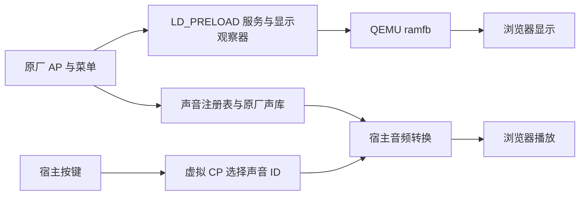

# A7 IV QEMU 的可复用源码与验证范围

观察项目：[16480000/sony-a7iv-qemu](https://github.com/16480000/sony-a7iv-qemu)。2026-10-31 复核的 main 为 `3637f15da850bea406bacd755381020b511b3867`，只有 main 分支，Issue、PR 和 GitHub Releases 列表为空。`v0.1` 标签仍指向较早的 `3fcc1c3d4157da5724619b61675f53dda826f906`，注解时间为2026-10-19；这次未发现新增发行。

这个项目最适合帮助我们研究同版 A7M4 6.02 的原厂菜单、资源和协议。源码中的原厂 AP 执行、虚拟 CP、网页声音和网页拍照必须分别判断。它没有证明照片或视频已经应用任意 3D LUT，也没有提供我们的声音共享菜单基线。

## 原厂 AP 如何运行

`work/sony-a7iv/prepare-menu-a7m4.py` 校验官方分区，提取原厂库、设置和 AP。QEMU 使用 virt 平台及补充的 Sony SCU DFS 寄存器模型，guest 运行特制 Linux。`bootin.elf` 启动原厂 `im.elf` 和 `appFw.so`，`LD_PRELOAD` 观察器提供缺少的服务、消息回复和显示能力。启动脚本还会过滤原厂服务列表。

SCU 模型完成 `upm.ko` 需要的寄存器握手，没有实现真实时钟树。通用总线替身和 SPAcc 替身也不能证明物理硬件兼容或加密行为。默认没有连接真实相机。



原厂 AP 像素与 ramfb 的逐像素比较可以核对菜单来源。它不能证明全部周边服务、真实输入、CP 或 ISP 行为等同真机。

源码入口：[输入提取](https://github.com/16480000/sony-a7iv-qemu/blob/3637f15da850bea406bacd755381020b511b3867/work/sony-a7iv/prepare-menu-a7m4.py)、[显示与服务适配](https://github.com/16480000/sony-a7iv-qemu/blob/3637f15da850bea406bacd755381020b511b3867/work/sony-a7iv/prepare-display-port.py)、[SCU 模型](https://github.com/16480000/sony-a7iv-qemu/blob/3637f15da850bea406bacd755381020b511b3867/work/sony-a7iv/sony_scu_dfs.c)。

## 同版菜单地址已用我们自己的 AP 核对

上游适配器要求 stock AP SHA256 为 `1e1b9202eaa69198f20df03dbfdab2f103b206cc4ebcd2e7bd817e6a710018a2`，与我们持有的原厂 6.02 输入一致。本机另写只读 ELF 检查，按唯一文件支持的 PT_LOAD 范围换算地址，重新读取 RTTI、GOT、工厂项和指令字，全部通过。

| 项目 | AP 虚拟地址或值 |
|---|---|
| RTTI 名称 | `19rep_menu_controller` |
| vptr | `0x599e090` |
| 构造器锚 | `0x1dc7504`，模式指令在 `0x1dc7518` |
| 模式编号 | `0x354` |
| 工厂入口 | `0x1dc769c` |
| vtable GOT | `0x5a300a0`，原值加 16 等于 vptr |
| 工厂表项 | `0x5118520 + 0x354 * 96 + 8` |

检查同时记录了四个对应的重定位项。复跑脚本与结果在本机 `output/expanded-features-20261030/verify_qemu_menu_anchors.py` 和 `qemu-menu-anchors.json`。该检查未执行 AP 指令或设备程序，不能据地址匹配启用菜单或调用目标函数。FL23、共享菜单候选均须另行核对，不默认沿用 stock 地址。

上游依据见 [prepare-display-port.py 第 365 行](https://github.com/16480000/sony-a7iv-qemu/blob/3637f15da850bea406bacd755381020b511b3867/work/sony-a7iv/prepare-display-port.py#L365)。这比搜索到同名字符串更适合用作菜单身份检查，但尚未补齐自定义菜单的全部回调。

本项目的只读工具可直接提取工厂记录，并重新编码核对原字节：

```sh
.venv-offline/bin/python -B -E -s tools/inspect_m4_factory_registry.py \
    --ap local/firmware/a7m4-6.02/stock/appFw.so --mode 0x354 \
    --output output/menu-factory-inspection-NEW.json
```

工具仅接受明确支持的 stock 或 FL23 AP 哈希，输出文件必须不存在。96 字节记录的两个函数指针以及 `+0x10/+0x14` 两个原始整数已由原厂读取代码核对；整数的业务含义未解释，其余 72 字节原样保留。后续原指令验证确认 `0x1ed6a58` 调用 `+0` 函数，`0x1ed6af4` 调用 `+8` 函数，另有独立函数使用有符号上界 `0x4ce`，并返回 `0x4cf` 作为 sentinel。原判定没有证明负数下界，检查工具自行拒绝负数，不改变原厂代码。

本机检查了 `0..0x4ce` 范围内 1231 条记录，均能原字节往返，记录了 2464 个相关重定位。内部的 `0x36d` 没有 factory，也不能据此当作自由槽。原声音所用卡、文件、确认、等待控制器分别对应 `0x15c/0x16b/0x174/0x2b2`，其 factory 到构造器的直接调用已核对。这些结果不表示新增声音菜单已生成或可达。测试在 `tests/test_m4_factory_registry.py`，原厂文件不随仓库分发。原始消费者与两种 AP 的对照证据保留在本机 `output/stock-factory-consumers-20261030/`。

## 声音演示怎样触发

`system-sound-model.c` 处理 endpoint `0x92840747` 的 `200d` 消息：`032e` 音量、`033d` 声库地址、`0327` 描述符、`032a` 单项音量、`0328` 路径、`0329` 播放请求。宿主能观察 AP 的请求日志。

另一条路径由宿主按键直接触发虚拟 CP：HALF 选择 ID4，SHUTTER 根据网页配置选择对应 ID。宿主通过 QMP 读取 guest 声库，再转换为 WAV 交浏览器播放。声库来源可以用哈希核对，**CP、AIP 的原生触发和解码并没有因此得到验证**。

[native-session.py](https://github.com/16480000/sony-a7iv-qemu/blob/3637f15da850bea406bacd755381020b511b3867/outputs/sony-a7iv-qemu/native/runtime/native-session.py) 中的 `fw_emit_registered`、`fw_decode_event` 和 `key_command` 是关键入口。`work/sony-a7iv/CURRENT.md` 解释了虚拟触发的原因：此前 AP 追踪未观察到 HALF、SHUTTER 下的预期播放请求。

我们可以复用协议字段与声库边界检查。宿主选 ID、宿主采样率和浏览器试听不能充当本机自定义快门声音验收。

## 网页照片怎样写入

浏览器从 video 元素取帧，用 canvas 编码 JPEG，限制并补齐为 65536 字节。宿主将内容经串口传给 guest，`virtual-photo-capture.c` 在虚拟卡预先准备好的 `DSC00001.JPG` 数据区执行 pwrite 并回读。网页回放显示宿主保留的 lastPhoto 覆盖层。

这条路径能测试传输和既有文件的数据区写入，没有经过 Sony 原厂传感器、ISP、JPEG 编码或原厂回放解码。它不适合作为我们的 LUT 照片、视频效果验收。

源码入口：[网页与上传](https://github.com/16480000/sony-a7iv-qemu/blob/3637f15da850bea406bacd755381020b511b3867/outputs/sony-a7iv-qemu/native/runtime/panel-server.py)、[guest 写卡 helper](https://github.com/16480000/sony-a7iv-qemu/blob/3637f15da850bea406bacd755381020b511b3867/work/sony-a7iv/virtual-photo-capture.c)。

## 复现时先核对版本和输入

`work/sony-a7iv/native-session.py`、`panel-server.py` 仍对应较早基线；后续声音、网页照片扩展在 `outputs/sony-a7iv-qemu/native/runtime/`。默认 `Start-Camera.ps1` 固定校验旧带卡 cpio，不能默认得到所有后续候选功能。

参考 QEMU 为 11.1.2，另需 Windows、WSL、原厂输入、参考分析材料和作者路径适配。部分依赖没有完整锁定；`prepare_sources.py` 会更新 main 的清单，却可能复用已有归档。上游明确未在干净电脑完成整套重建。本轮没有运行上游程序或启动模拟器。

allquiet35 的 AP 为 `5b22d6b24b335ff157d79db496ff8081a828ab96dcfaa983e1e77bfb1dc90f10`，与 stock 仅差 32 字节，CP 保持 stock。它不等于声音配方所需的共享菜单 AP `28bd9760…`、CP `1c34764f…`，不能替代这些输入。其 AP 成功启动记录也没有证明真实 LUT 导入或图像效果。

完整本机研究记录在 `output/m4-qemu-deep-20261030/`，包括 116 份脱敏文本、逐文件来源索引、基线比较、依赖图及完整报告。没有下载固件、声库或密钥，没有把虚拟硬件替身接入我们的安装包。
